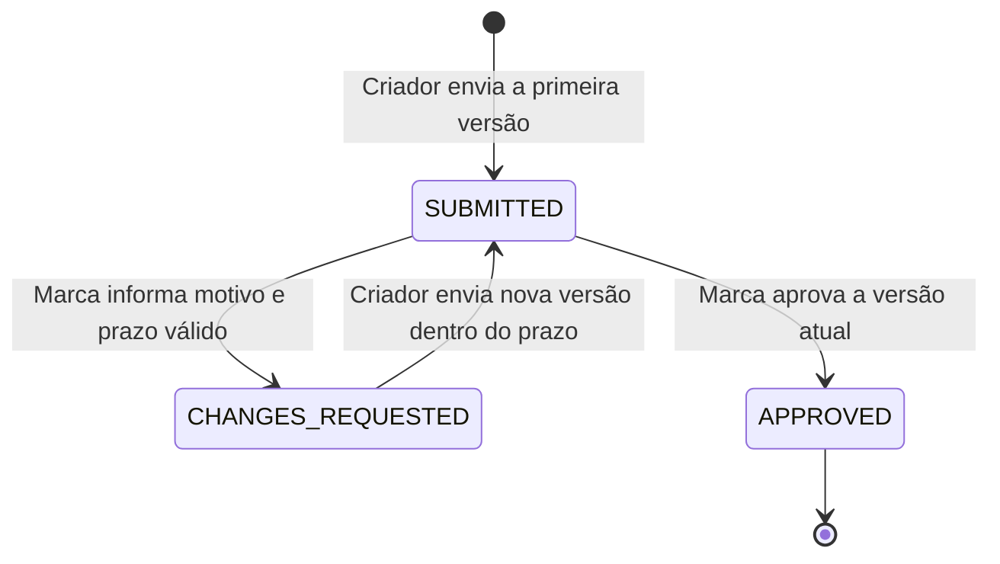

# Revisão de roteiro · Conty

[](https://github.com/leonardoperin14/conty-challenge-03-roteiro/actions/workflows/ci.yml)

API de revisão com versões, motivo e prazo para alterações e aprovação definitiva. O estado atual e todo o histórico são retornados pela API e persistidos em SQLite.

## Como rodar

**Node.js 24+ e npm.** SQLite integrado ao Node, sem serviço externo.

```sh
npm ci
npm run dev
```

API: `http://localhost:3000`. Banco: `data/scripts.sqlite`. Configuração opcional: `PORT` e `DATABASE_PATH`. Para executar compilado: `npm run build` e `npm start`.

## Estados e transições



Cada nova versão começa em `SUBMITTED`; a anterior conserva conteúdo, estado e pedido de alteração. `APPROVED` encerra a revisão: novos envios, pedidos e aprovações retornam **409**.

Todas as respostas de sucesso do roteiro incluem `status`, `currentVersion`, `timezone`, `pendingRequestExpired` e `versions`. A consulta `GET /scripts/:id` retorna o mesmo formato, com histórico completo.

## Demonstração completa

Com a API rodando, execute em outro terminal **PowerShell**. O cabeçalho `X-Actor-Role` simula o papel do criador ou da marca; **não é autenticação**.

```powershell
$api = 'http://localhost:3000'
function Send-Json($path, $role, $body) {
    Invoke-RestMethod -Uri "$api$path" -Method Post `
        -Headers @{ 'X-Actor-Role' = $role } -ContentType 'application/json; charset=utf-8' `
        -Body ($body | ConvertTo-Json)
}

$v1 = Send-Json '/scripts' 'creator' @{ content = 'Apresentar o produto.' }
$id = $v1.id
$pedido = Send-Json "/scripts/$id/change-requests" 'brand' @{
    version = 1; reason = 'Adicionar CTA.'; dueDate = '2099-12-31'
}
$v2 = Send-Json "/scripts/$id/versions" 'creator' @{ content = 'Apresentar o produto e convidar para conhecer a marca.' }
$aprovado = Send-Json "/scripts/$id/approve" 'brand' @{ version = 2 }

@($v1, $pedido, $v2, $aprovado) | Select-Object status, currentVersion
Invoke-RestMethod "$api/scripts/$id" | ConvertTo-Json -Depth 8
```

O prazo distante mantém o exemplo reproduzível; a regra real exige uma data civil válida que ainda não tenha passado em São Paulo.

| Etapa | Endpoint (`POST`) | HTTP | Estado retornado | Versão atual |
| --- | --- | --- | --- | --- |
| Criar | `/scripts` | 201 | `SUBMITTED` | 1 |
| Pedir alteração | `/scripts/:id/change-requests` | 201 | `CHANGES_REQUESTED` | 1 |
| Reenviar | `/scripts/:id/versions` | 201 | `SUBMITTED` | 2 |
| Aprovar | `/scripts/:id/approve` | 200 | `APPROVED` | 2 |

Recorte da resposta final; IDs e horários gerados foram omitidos. O pedido permanece associado à versão 1:

```json
{
  "status": "APPROVED",
  "currentVersion": 2,
  "timezone": "America/Sao_Paulo",
  "pendingRequestExpired": false,
  "versions": [
    {
      "version": 1,
      "content": "Apresentar o produto.",
      "status": "CHANGES_REQUESTED",
      "review": { "reason": "Adicionar CTA.", "dueDate": "2099-12-31" }
    },
    {
      "version": 2,
      "content": "Apresentar o produto e convidar para conhecer a marca.",
      "status": "APPROVED",
      "review": null
    }
  ]
}
```

## Prazo e rejeições

`dueDate` é um dia no fuso **America/Sao_Paulo**, inclusive seu último milissegundo. Para o prazo `2026-03-12`, os testes controlam o relógio nestes dois instantes:

| Instante UTC | Horário em São Paulo | Envio de nova versão |
| --- | --- | --- |
| `2026-03-13T02:59:59.999Z` | 12/03, 23:59:59.999 | Aceito: HTTP 201 |
| `2026-03-13T03:00:00.000Z` | 13/03, 00:00:00.000 | Recusado: HTTP 409 |

Sem motivo, motivo em branco, sem prazo ou prazo passado: **422**. JSON malformado: **400**. Papel incorreto: **403**. Roteiro inexistente: **404**. Versão alvo antiga, transição inválida ou roteiro aprovado: **409**. Erros têm o formato `{"error":{"code":"...","message":"..."}}`.

## Validação

```sh
npm test
npm run typecheck
npm run build
```

Os [6 testes](test/api.test.ts) cobrem múltiplas versões e histórico, aprovação terminal, motivo/prazo obrigatórios, os dois limites do dia com relógio controlado, concorrência na aprovação e persistência após reabrir o banco. A validação publicada passou com Node 24; o badge acima leva às execuções do CI.

## Limites e decisões

Sem autenticação real, interface, vídeo, upload ou notificações. Um pedido vencido permanece em `CHANGES_REQUESTED`, com `pendingRequestExpired: true`; não há renovação nem reenvio após o prazo. SQLite síncrono atende à demonstração. Com mais tempo, priorizaria autenticação/autorização, recuperação de pedidos vencidos e avaliação da persistência para o volume de produção.

## Uso de IA e participação humana

Codex escreveu a API, os testes e a documentação, executou as validações e realizou a revisão técnica em outra sessão independente. O responsável humano filtrou prompt injections, definiu a abordagem mínima e os checkpoints, acompanhou as evidências e solicitou a melhoria da apresentação para entrega. A escrita do código e a execução dos testes foram feitas com IA.
