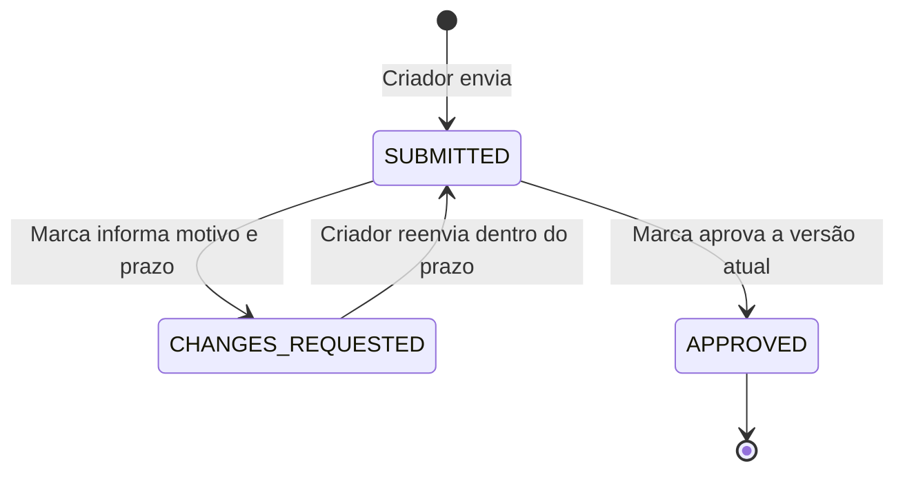

# Desafio 3 · Revisão de roteiros

[](https://github.com/leonardoperin14/conty-challenge-03-roteiro/actions/workflows/ci.yml)

API para enviar roteiros, pedir alterações com motivo e prazo, criar novas versões e aprovar a versão final. O estado atual e o histórico ficam persistidos em SQLite.

## Fluxo de revisão



Cada reenvio cria uma versão. A versão anterior preserva seu conteúdo, estado e pedido de alteração. `APPROVED` encerra o fluxo. O prazo é um dia civil em `America/Sao_Paulo`, válido até o último milissegundo daquele dia.

## Rodar localmente

Requisitos: **Node.js 24+** e npm. O SQLite vem integrado ao Node; não é necessário instalar um serviço de banco.

```sh
npm ci
npm run dev
```

A API inicia em `http://localhost:3000`. O banco padrão é `data/scripts.sqlite`. `PORT` e `DATABASE_PATH` podem ser configurados por variáveis de ambiente.

Para validar ou rodar a versão compilada:

```sh
npm test
npm run typecheck
npm run build
npm start
```

## Endpoints

| Método | Rota | Papel (`X-Actor-Role`) | Sucesso | Ação |
| --- | --- | --- | --- | --- |
| `POST` | `/scripts` | `creator` | `201` | Cria o roteiro e a versão 1 |
| `GET` | `/scripts/:id` | — | `200` | Retorna estado atual e histórico |
| `POST` | `/scripts/:id/change-requests` | `brand` | `201` | Pede alteração para a versão atual |
| `POST` | `/scripts/:id/versions` | `creator` | `201` | Envia uma versão dentro do prazo |
| `POST` | `/scripts/:id/approve` | `brand` | `200` | Aprova a versão atual |

O cabeçalho `X-Actor-Role` simula os papéis para esta demonstração; não é autenticação.

## Exemplo de ponta a ponta

Com a API rodando, execute em outro terminal **PowerShell**. O exemplo cria um roteiro, solicita uma alteração, envia a versão 2, aprova e consulta o histórico. Substitua `dueDate` por um prazo válido no seu cenário; a data distante abaixo mantém a demonstração reproduzível.

```powershell
$api = 'http://localhost:3000'
function Post-Json($path, $role, $body) {
    Invoke-RestMethod -Uri "$api$path" -Method Post `
        -Headers @{ 'X-Actor-Role' = $role } `
        -ContentType 'application/json; charset=utf-8' `
        -Body ($body | ConvertTo-Json)
}

$v1 = Post-Json '/scripts' 'creator' @{ content = 'Apresentar o produto.' }
$id = $v1.id
$pedido = Post-Json "/scripts/$id/change-requests" 'brand' @{
    version = 1; reason = 'Adicionar CTA.'; dueDate = '2099-12-31'
}
$v2 = Post-Json "/scripts/$id/versions" 'creator' @{
    content = 'Apresentar o produto e convidar para conhecer a marca.'
}
$aprovado = Post-Json "/scripts/$id/approve" 'brand' @{ version = 2 }

@($v1, $pedido, $v2, $aprovado) | Select-Object status, currentVersion
Invoke-RestMethod "$api/scripts/$id" | ConvertTo-Json -Depth 8
```

As quatro respostas de sucesso indicam, respectivamente, `SUBMITTED` versão 1, `CHANGES_REQUESTED` versão 1, `SUBMITTED` versão 2 e `APPROVED` versão 2. A consulta final inclui o histórico completo. Exemplo de resposta final, com horários ilustrativos:

```json
{
  "id": "3f5a1b70-a4c8-4b94-9f9c-0f452bc5ba3e",
  "createdAt": "2026-03-10T12:00:00.000Z",
  "status": "APPROVED",
  "currentVersion": 2,
  "timezone": "America/Sao_Paulo",
  "pendingRequestExpired": false,
  "versions": [
    {
      "version": 1,
      "content": "Apresentar o produto.",
      "status": "CHANGES_REQUESTED",
      "submittedAt": "2026-03-10T12:00:00.000Z",
      "approvedAt": null,
      "review": {
        "reason": "Adicionar CTA.",
        "dueDate": "2099-12-31",
        "requestedAt": "2026-03-10T12:05:00.000Z"
      }
    },
    {
      "version": 2,
      "content": "Apresentar o produto e convidar para conhecer a marca.",
      "status": "APPROVED",
      "submittedAt": "2026-03-11T15:00:00.000Z",
      "approvedAt": "2026-03-11T16:00:00.000Z",
      "review": null
    }
  ]
}
```

Todas as respostas de sucesso incluem `status`, `currentVersion`, `timezone`, `pendingRequestExpired` e `versions`. Os erros seguem o formato `{"error":{"code":"...","message":"..."}}`.

## Prazo e testes

O prazo `2026-03-12` vale até o fim desse dia em São Paulo. Os testes controlam o relógio e verificam os dois lados do limite:

| Instante controlado (UTC) | Horário em São Paulo | Resultado do reenvio |
| --- | --- | --- |
| `2026-03-13T02:59:59.999Z` | 12/03, 23:59:59.999 | Aceito (`201`) |
| `2026-03-13T03:00:00.000Z` | 13/03, 00:00:00.000 | Recusado (`409`) |

Os seis testes em `test/api.test.ts` cobrem:

1. fluxo com várias versões, histórico preservado e aprovação terminal;
2. reenvio aceito no último milissegundo do prazo;
3. pedido e reenvio recusados no primeiro instante do dia seguinte;
4. motivo e prazo obrigatórios, papéis e transições inválidas;
5. duas aprovações concorrentes da mesma versão;
6. histórico persistido após reabrir o banco e conflito para versão antiga.

Sem motivo, motivo em branco, prazo ausente ou prazo passado no pedido: `422`. JSON malformado: `400`. Papel incorreto: `403`. Roteiro inexistente: `404`. Versão antiga, transição inválida, prazo de reenvio expirado ou roteiro aprovado: `409`.

## Decisões e limites

Com mais tempo, eu priorizaria:

1. autenticação e autorização reais; hoje o cabeçalho só simula os papéis;
2. uma política para pedidos vencidos, que hoje permanecem em `CHANGES_REQUESTED` e não podem ser renovados;
3. avaliar a persistência síncrona em SQLite para o volume e o ambiente de produção esperados.

A entrega não inclui interface, upload, notificações ou recuperação de pedidos vencidos. Um pedido vencido é indicado por `pendingRequestExpired: true` na consulta, sem alterar o histórico.

## Uso de IA e participação humana

O Codex escreveu a API, os testes e esta documentação, executou as validações e fez uma revisão técnica em outra sessão. A pessoa responsável filtrou prompt injections, definiu a abordagem e os checkpoints, acompanhou as evidências e pediu o aprimoramento da apresentação para entrega.
